# Adventis Global — Lab 03

## Modernizing to PaaS & Securing Secrets with Azure

**Project:** Secure Employee Records Portal  
**Cloud platform:** Microsoft Azure  
**Environment:** Adventis Global (fictional enterprise)  
**Outcome:** Deployment completed; functional tests passed  
**Production readiness:** Demonstration environment — further hardening required

## 1. Project Overview

Adventis Global is a fictional enterprise modernizing an internal employee directory. The engineering objective was to host a Python web application on an Azure Linux virtual machine while moving the data tier to **Azure SQL Database (PaaS)** and avoiding hard-coded database passwords.

The finished portal displays five fictional employee records. The application obtains its SQL credential from **Azure Key Vault**, using the VM's **system-assigned managed identity** to authenticate to the vault. **Nginx → Gunicorn → Flask** serves the application, and an **SSH tunnel** allows browser access without opening inbound HTTP to the internet.

### Objectives

- Provision Azure networking, an Ubuntu VM, and Azure SQL Database.
- Create and query a sample employee directory.
- Store the SQL password in Key Vault rather than application source code.
- Grant the VM identity the minimum Key Vault role required to read secrets.
- Deploy the application behind Gunicorn, systemd, and Nginx.
- Verify connectivity, secret retrieval, SQL queries, service health, and browser access.
- Document security boundaries, troubleshooting, and production improvements.

## 2. Solution Architecture

**[View the detailed architecture diagram](diagrams/architecture.md)**

```text
Windows browser (http://localhost:8080)
             |
     Encrypted SSH tunnel
             |  local 8080 -> VM 127.0.0.1:80
             v
 Azure VM: ADV-WEB01 (East US)
             |
         Nginx :80
             |
      Gunicorn :8000 (loopback)
             |
         Flask application
           /     \
          /       \  Encrypted SQL connection (TCP 1433)
         v         v
 VM managed       Azure SQL Database
 identity         ADV-EmployeeDB (UK South)
         |
         v
 Azure Key Vault (UK South)
 adv-kv-lab03-2
         |
 SQL password returned to application at runtime
```

**Request flow:** The administrator connects through SSH port forwarding. Nginx forwards local HTTP requests to Gunicorn, which runs Flask. Flask uses the VM's managed identity to retrieve a SQL password from Key Vault, then connects to Azure SQL Database over an encrypted connection and renders the employee records.

**Identity boundary:** Managed identity authenticates to **Key Vault**, not directly to SQL in this implementation. SQL access uses a SQL login and a password retrieved at runtime. The SSH tunnel encrypts traffic between the administrator's machine and the VM; the HTTP service on the VM remains HTTP.

## 3. Technology Stack

| Component | Purpose |
|---|---|
| Azure Virtual Machine / Ubuntu 24.04 LTS | Application host |
| Azure Virtual Network and Network Security Group | Network segmentation and inbound restrictions |
| Azure SQL Database | Managed relational data tier |
| Azure Key Vault | SQL credential storage |
| System-assigned managed identity and Azure RBAC | Passwordless VM-to-Key-Vault authentication and scoped secret access |
| Python 3, Flask | Web application |
| pyodbc and Microsoft ODBC Driver 18 | Encrypted SQL connectivity |
| Gunicorn | WSGI application server |
| systemd | Application process supervision and startup |
| Nginx | Reverse proxy |
| SSH port forwarding | Restricted browser access for the lab |
| Git and GitHub | Version-controlled documentation |

## 4. Azure Infrastructure and Network Design

| Resource / setting | Lab configuration |
|---|---|
| Resource group | `RG-ADV-LAB03` |
| Web VM | `ADV-WEB01`, Ubuntu 24.04 LTS, East US |
| Virtual network | `ADV-VNET03` |
| Web subnet | `ADV-WEB-SUBNET`, `10.30.1.0/24` |
| Network security group | `ADV-WEB-NSG` |
| VM private address | `10.30.1.4` at the time of testing |
| VM public address | `52.224.244.164` at the time of testing |
| Azure SQL logical server | `adv-sql-lab03-1.database.windows.net` |
| Azure SQL database | `ADV-EmployeeDB`, UK South |
| Key Vault | `adv-kv-lab03-2`, UK South |

### Network controls

The subnet NSG included an `Allow-SSH-MyIP` inbound rule for **TCP 22**, limited to an approved administrator IPv4 `/32`. Historical screenshots show the source IP configured at that time; this should not be assumed to be the administrator's current address. No inbound internet-facing HTTP rule was required to view the portal.

Azure SQL used a **public endpoint**, with an SQL server firewall rule named `Allow-ADV-WEB01` permitting the web VM's public IPv4 address. A screenshot of the SQL firewall rule was **not retained**; the rule is documented from the lab implementation, not claimed as separately screenshot-verified. TCP port 1433 reachability and subsequent authenticated SQL queries were tested independently.

**Regional decision:** Subscription restrictions prevented the intended East US SQL deployment, so Azure SQL and Key Vault were deployed in **UK South** while the VM remained in **East US**. This was an accommodation for the lab, not a recommended default for production architecture.

### Infrastructure evidence

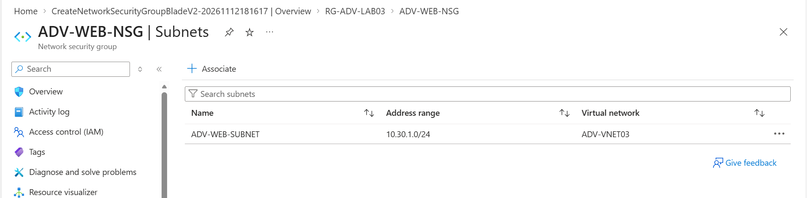

*Subnet and NSG association at the time of deployment.*

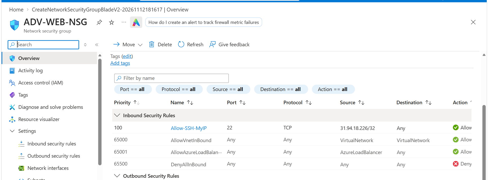

*SSH access restricted to the approved administrator IPv4 /32 at the time of capture.*


*VM deployment overview. An early VM Agent “Not Ready” warning is discussed in Section 13; this screenshot is not proof of full agent health.*

## 5. Azure SQL Database and Sample Data

Azure SQL Database replaced a self-managed database VM for the data tier.

| Database setting | Configuration |
|---|---|
| Compute | General Purpose — Serverless |
| Maximum vCores | 1 |
| Minimum vCores | 0.5 |
| Auto-pause delay | 1 hour |
| Maximum storage | 32 GB |

The `dbo.Employees` table was created with the following schema:

```sql
CREATE TABLE dbo.Employees (
    EmployeeID INT IDENTITY(1,1) PRIMARY KEY,
    FirstName NVARCHAR(50) NOT NULL,
    LastName NVARCHAR(50) NOT NULL,
    Department NVARCHAR(50) NOT NULL,
    JobTitle NVARCHAR(100) NOT NULL,
    Email NVARCHAR(150) NOT NULL UNIQUE
);
```

Five fictional records were inserted for **IT, Finance, HR, Sales, and Operations**. Azure SQL Query Editor returned all five rows; the Flask application later retrieved the same record count.

### Database evidence

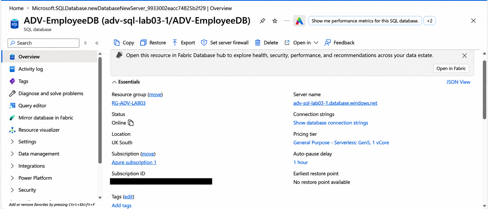

*Azure SQL Database configuration and serverless tier.*

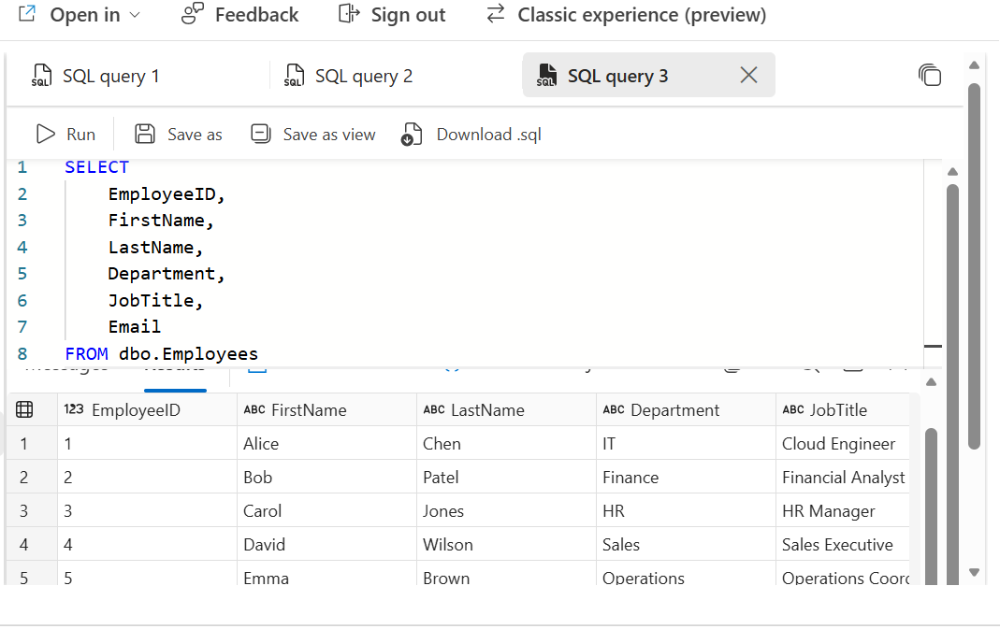

*Query Editor results for the five sample employees.*

## 6. Identity, Key Vault, and Secret Management

1. Enabled the **system-assigned managed identity** on `ADV-WEB01`.
2. Created Key Vault `adv-kv-lab03-2` with the **Azure RBAC** permission model.
3. Assigned the deployment user **Key Vault Secrets Officer** at the vault scope to create the secret.
4. Created the secret `adv-sql-admin-password`, containing the existing SQL administrator password.
5. Assigned **Key Vault Secrets User** to the `ADV-WEB01` managed identity **at the vault resource scope**.
6. Tested managed identity authentication and secret retrieval without printing the password.
7. Used the retrieved credential to establish an authenticated SQL connection and query the employee records.

The secret value, SSH private key, and authentication tokens are **not included** in this repository.

**Security qualification:** The application still used the **SQL administrator login**. Key Vault improved credential handling but did not make that SQL identity least-privileged. The Key Vault had **soft delete enabled** and **purge protection disabled** during the lab; this is documented as a lab setting, **not** a production security recommendation.

### Identity and Key Vault evidence

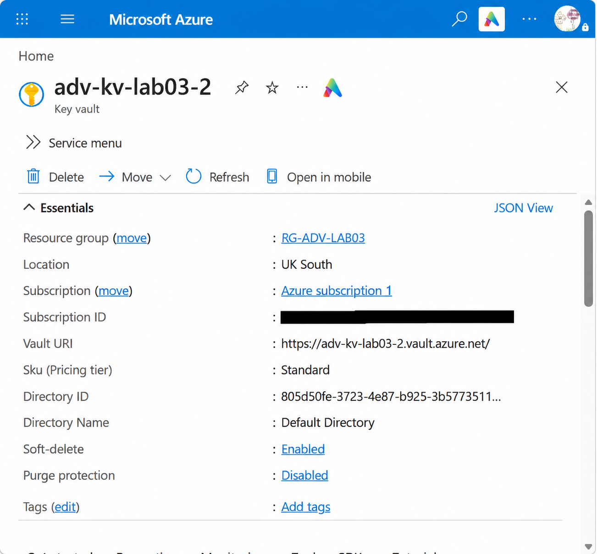

*Key Vault deployment and settings, including the lab's disabled purge protection.*

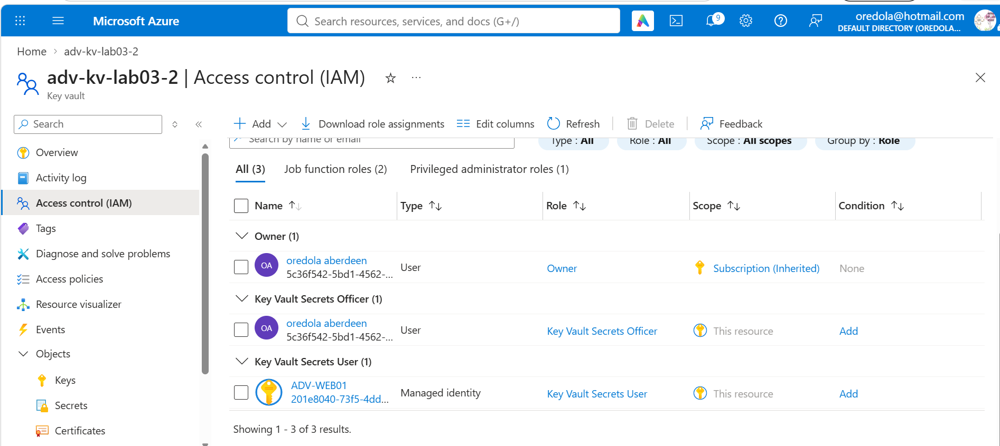

*Vault-scoped Key Vault Secrets User assignment. This is not a screenshot of the VM Identity blade.*

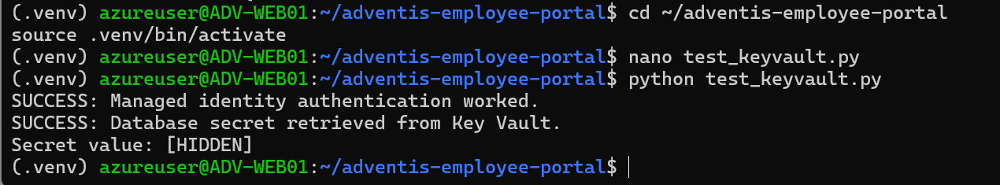

*The test confirms secret retrieval without exposing the password.*

## 7. Application Development and Dependencies

The application was developed on the Ubuntu VM in:

```text
/home/azureuser/adventis-employee-portal
```

The VM was prepared with Python 3, pip, virtual environment support, Nginx, and ODBC prerequisites. Within the virtual environment, the application dependencies were installed:

```bash
python3 -m venv .venv
source .venv/bin/activate
pip install flask gunicorn pyodbc azure-identity azure-keyvault-secrets
```

**Microsoft ODBC Driver 18 for SQL Server** was installed separately and verified with `odbcinst -q -d`.

The Flask application:

- Authenticates to Key Vault using the VM identity.
- Retrieves `adv-sql-admin-password` at runtime.
- Connects to `ADV-EmployeeDB` using `pyodbc`.
- Enables encryption and SQL server certificate validation in its connection configuration.
- Queries `dbo.Employees` and renders an HTML table.

The local Flask development-server test returned **HTTP 200** and **five employee records**. The development server was for testing; the final deployment used Gunicorn.

### Application evidence

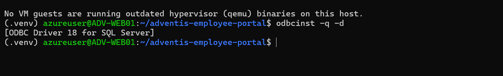

*Microsoft ODBC Driver 18 registered on Ubuntu.*

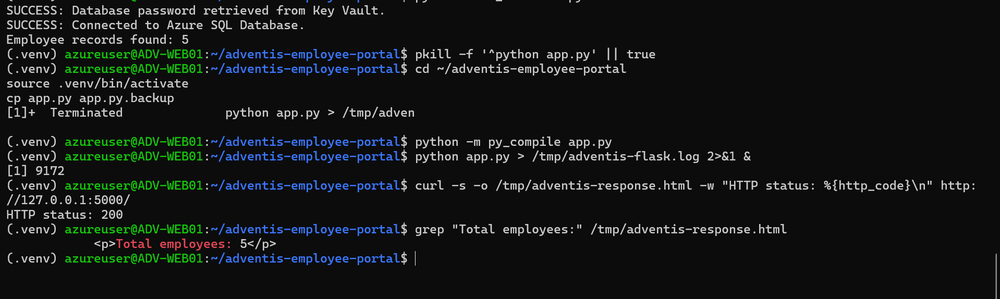

*Local Flask application validation before switching to Gunicorn.*

## 8. Gunicorn and systemd

Gunicorn served Flask on **`127.0.0.1:8000`**, keeping the application server bound to the VM's loopback interface. A systemd unit named `adventis-portal.service` supervised the process and enabled startup with the VM.

The lab's service configuration was:

```ini
[Unit]
Description=Adventis Global Employee Portal
After=network-online.target
Wants=network-online.target

[Service]
User=azureuser
Group=azureuser
WorkingDirectory=/home/azureuser/adventis-employee-portal
Environment="PATH=/home/azureuser/adventis-employee-portal/.venv/bin"
ExecStart=/home/azureuser/adventis-employee-portal/.venv/bin/gunicorn --workers 2 --bind 127.0.0.1:8000 --timeout 120 app:app
Restart=on-failure
RestartSec=5
NoNewPrivileges=true

[Install]
WantedBy=multi-user.target
```

Validation included `systemctl` service checks and an HTTP request to `127.0.0.1:8000`. The service was **active**, **enabled**, and returned **HTTP 200** with five employee records at the time of testing.

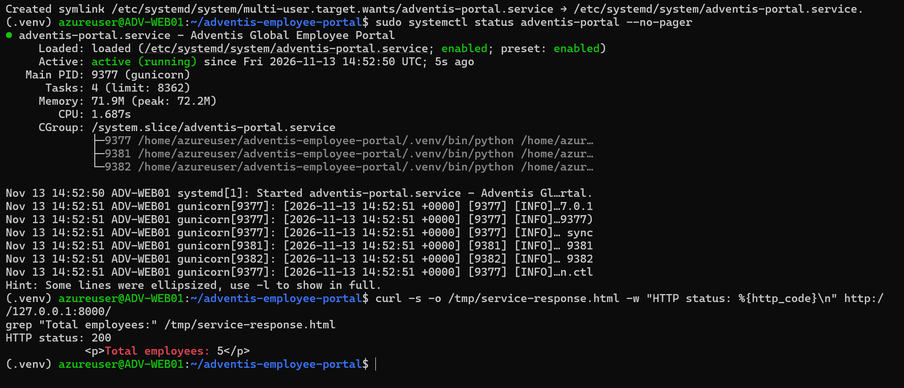

*Gunicorn service status and HTTP response validation.*

## 9. Nginx Reverse Proxy

Nginx listened on VM port **80** and forwarded requests to Gunicorn on **`127.0.0.1:8000`**. The configuration used during the lab was:

```nginx
server {
    listen 80;
    server_name _;

    location / {
        proxy_pass http://127.0.0.1:8000;
        proxy_set_header Host $host;
        proxy_set_header X-Real-IP $remote_addr;
        proxy_set_header X-Forwarded-For $proxy_add_x_forwarded_for;
        proxy_set_header X-Forwarded-Proto $scheme;
        proxy_connect_timeout 10s;
        proxy_read_timeout 150s;
    }
}
```

`sudo nginx -t` passed, and a local HTTP request through Nginx returned **HTTP 200** and **five employee records**. The absence of an inbound internet-facing port 80 rule was part of the lab access design.

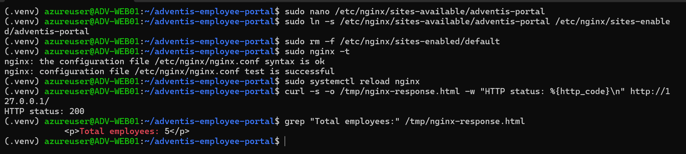

*Nginx configuration syntax and reverse-proxy response checks.*

## 10. Browser Access Through an SSH Tunnel

From the local Windows workstation, the administrator opened an SSH tunnel to the VM:

```powershell
ssh -i "$env:USERPROFILE\Downloads\ADV-WEB01-key.pem" -L 8080:127.0.0.1:80 azureuser@<VM_PUBLIC_IP>
```

The portal was then opened in the Windows browser at:

```text
http://localhost:8080
```

The browser displayed **Adventis Global — Employee Records Portal**, a successful database connection message, and all five fictional employee records.

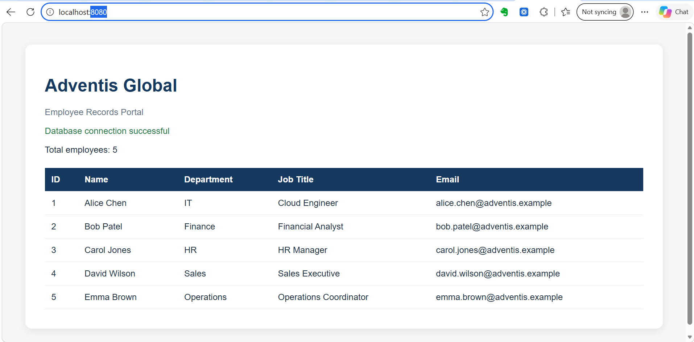

*Final browser view accessed through the SSH tunnel.*

**Scope:** SSH port forwarding was suitable for controlled lab access. It is **not** a substitute for application-level user authentication, authorization, or a production HTTPS access architecture.

## 11. Testing and Validation

| Test | Verified outcome | Result |
|---|---|---|
| SSH connection | VM login succeeded | Pass |
| VM outbound connectivity | DNS, HTTPS, package update, and route checks succeeded | Pass |
| Azure SQL TCP connection | Port 1433 reachable from VM | Pass |
| Managed identity → Key Vault | Authentication succeeded | Pass |
| Secret retrieval | Secret retrieved without displaying its value | Pass |
| Azure SQL authentication | `pyodbc` connection succeeded using the retrieved credential | Pass |
| SQL query | Five employee records returned | Pass |
| Flask development test | HTTP 200; five records | Pass |
| Gunicorn / systemd | Service active and enabled; HTTP 200; five records | Pass |
| Nginx reverse proxy | Configuration valid; HTTP 200; five records | Pass |
| Browser over SSH tunnel | Portal displayed at `localhost:8080` | Pass |

These tests demonstrate that the application was functioning **at the time of validation**. They do not constitute a continuous monitoring record, a penetration test, or proof of production readiness.

## 12. Troubleshooting and Lessons Learned

### Intermittent SSH connectivity

**Observed:** Some SSH connection attempts timed out. **Checks performed:** VM running state, public IP, NSG inbound rule, and the administrator's approved source IPv4. **Outcome:** SSH access was restored. **Lesson:** Validate network controls and changing client IPs before modifying application components. The precise cause of every timeout was not independently established.

### Key Vault secret creation permissions

**Observed:** The deployment account initially lacked permission to create a secret. **Resolution:** Assigned **Key Vault Secrets Officer** at the vault scope. **Lesson:** Azure resource management permissions and Key Vault secret data-plane permissions are distinct.

### Initial Azure SQL `pyodbc.OperationalError`

**Observed:** An early Python database connection failed. **Investigation:** Improved exception reporting. **Outcome:** A subsequent attempt succeeded without changing the SQL credentials or connection settings. **Possible, unconfirmed explanation:** The serverless database may have been resuming after auto-pause. The original detailed error was not retained, so **the root cause cannot be confirmed**.

## 13. Screenshot Evidence and Limitations

Evidence is organised into the existing repository folders:

```text
screenshots/
├── infrastructure/
├── database/
├── security/
└── application/
```

### Evidence register

The table identifies **what each evidence type supports**. Images embedded above use relative paths within this repository. The preview will display them only after the matching image files are copied into those folders. Optional screenshots are not required.

| Evidence | Folder | What it demonstrates / qualification |
|---|---|---|
| NSG creation and subnet association | `infrastructure/` | Provisioning and association of the network security group |
| NSG inbound SSH rule | `infrastructure/` | TCP 22 restricted to a historical administrator `/32`; not proof of the current rule |
| VM overview | `infrastructure/` | VM configuration and running state at capture; the Azure VM Agent was marked **Not Ready** in an early capture |
| VM outbound connectivity tests | `infrastructure/` | Successful DNS, HTTPS, package update, and route checks |
| Azure SQL database overview | `database/` | Database name, region, status, and serverless configuration |
| SQL Query Editor results | `database/` | Five fictional employee records returned by a SQL query |
| SQL connection test | `database/` | Secret retrieval, authenticated SQL connection, and five records; more than a TCP reachability check |
| Key Vault overview | `security/` | Vault deployment and settings; **purge protection disabled** in this lab |
| Key Vault IAM role assignments | `security/` | **Key Vault Secrets User** assigned to the VM managed identity; does not independently show the VM Identity settings blade |
| Managed identity / Key Vault terminal test | `security/` | Successful identity authentication and secret retrieval, with the secret hidden |
| Python and ODBC environment | `application/` | Installed dependencies and SQL driver |
| Flask application test | `application/` | HTTP 200 and five records via the local development server |
| Gunicorn and systemd test | `application/` | Service active/enabled; HTTP 200 and five records via Gunicorn |
| Nginx validation | `application/` | Nginx syntax test and HTTP 200 with five records through the reverse proxy |
| Browser portal | `application/` | Five records displayed through `localhost:8080` |

### Evidence interpretation

- **VM Agent warning:** An early VM screenshot reports **Agent status: Not Ready**. This does not invalidate later successful application tests, but that image should not be described as proof of complete VM health.
- **Managed identity:** Key Vault IAM evidence demonstrates the VM identity's assigned vault role. The successful SDK test provides functional evidence that the identity could authenticate and retrieve the secret. A separate screenshot of the VM Identity blade was not confirmed as retained.
- **SQL firewall:** No dedicated screenshot of `Allow-ADV-WEB01` was retained. The rule is described in the deployment narrative, while the SQL connection test independently establishes successful authenticated access at the time of testing.
- **Key Vault purge protection:** The screenshot shows it **disabled**. This is a lab configuration and a documented production improvement, not a recommended production setting.
- **Historical state:** Screenshots reflect their capture times. Public IPs, agent health, resource state, and access rules may subsequently change.
- **Sensitive information:** No passwords, private keys, or secret values should be published. The evidence reviewed for this project was intended to avoid displaying those values.

## 14. Security Review and Production Improvements

This lab demonstrates several security controls but was **not** designed or validated as a production-hardened employee information system.

| Area | Lab implementation | Recommended production improvement |
|---|---|---|
| Administrator access | SSH limited to an approved public IP | Evaluate Azure Bastion or approved private administration; maintain access controls and audit logs |
| Portal access | SSH tunnel to Nginx over local HTTP | Introduce HTTPS, application authentication, authorization, and appropriate private access controls |
| Key Vault authorization | VM identity granted **Key Vault Secrets User** at vault scope | Review scope and permissions regularly; audit secret access and rotate credentials |
| Key Vault deletion protection | Soft delete enabled; **purge protection disabled** | Enable purge protection and establish recovery procedures |
| SQL credentials | SQL administrator password stored in Key Vault | Use a least-privileged application identity; consider Microsoft Entra authentication |
| SQL networking | Public SQL endpoint restricted with a firewall rule | Consider a private endpoint, private DNS, and disabling public network access |
| Regional placement | VM in East US; SQL and Key Vault in UK South | Review latency, data residency, resiliency, and cross-region data-transfer implications |
| Reliability and monitoring | Manual functional checks | Add Azure Monitor, structured application logs, health checks, and alerts |
| Deployment | Manual configuration | Introduce infrastructure as code, CI/CD, and repeatable deployment tests |
| Data protection | Five fictional records | Define production data governance, backup/recovery testing, and access reviews |

**Important distinction:** Storing a password in Key Vault and retrieving it with managed identity avoids embedding that secret in code. It does **not** eliminate SQL password authentication or automatically make the database permissions least-privileged.

## 15. Key Learning Outcomes

This project provided hands-on experience with Azure VM networking, SQL PaaS provisioning, Azure RBAC, managed identities, Key Vault integration, Python-to-SQL connectivity, Linux service management, reverse proxying, SSH tunnels, and evidence-based technical documentation.

The main architectural lesson was learning to trace an end-to-end request across **browser → SSH tunnel → Nginx → Gunicorn → Flask → Key Vault and Azure SQL**, while distinguishing network access, identity, secret access, and database authentication.

## 16. Project Status and Cleanup

| Item | Status |
|---|---|
| Infrastructure and application deployment | Completed |
| Functional validation | Passed at time of testing |
| Evidence review | Documented with limitations |
| Production hardening | Recommended; not implemented |
| Azure resource cleanup | **Not yet confirmed in the available project record** |

**Cost note:** The VM, SQL database, Key Vault, and associated networking resources may incur charges while retained. Verify whether the lab resources are still needed, and record cleanup evidence when the resources are removed. Do not mark cleanup complete until verified.

---

## Disclaimer

Adventis Global is a fictional enterprise and the employee records are fictional. This project documents a practical cloud engineering exercise, not a production-ready system or a security certification.
