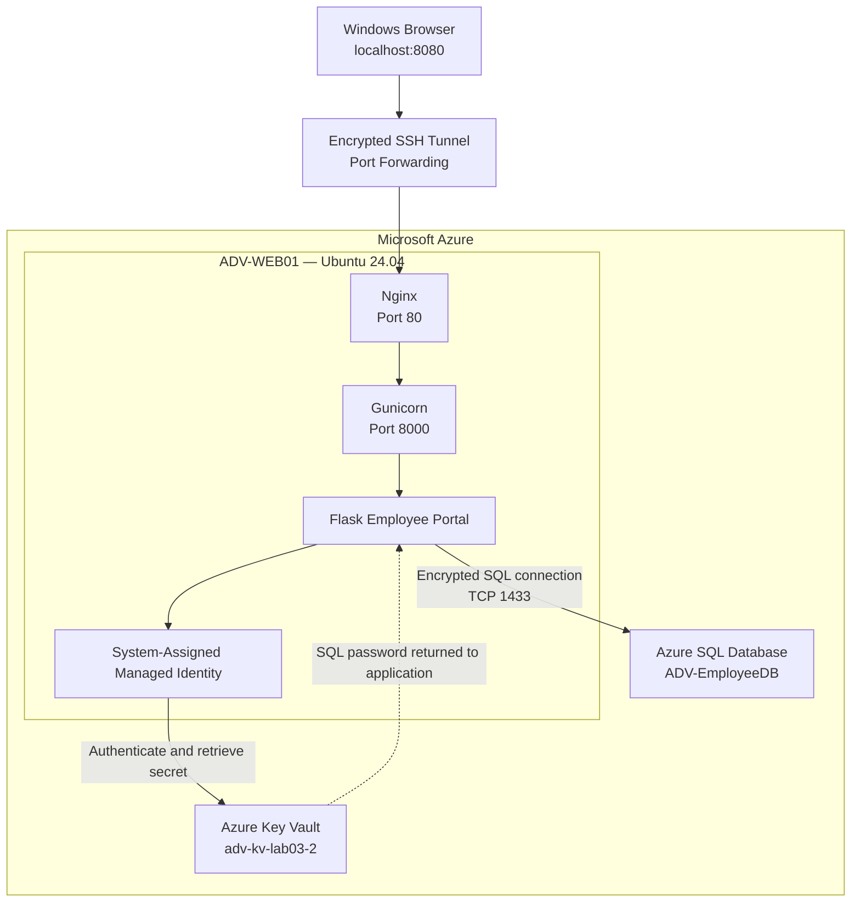

# Adventis Global — Lab 03 Architecture

## Architecture Notes

- The Ubuntu VM hosts Nginx, Gunicorn and Flask.
- Nginx forwards requests to Gunicorn on localhost.
- The VM uses a system-assigned managed identity to access Azure Key Vault.
- Key Vault stores the SQL administrator password.
- Flask retrieves the password at runtime and queries Azure SQL.
- The portal was accessed through an SSH tunnel without publicly exposing HTTP port 80.
- Azure SQL and Key Vault were deployed in UK South; the VM was deployed in East US.
